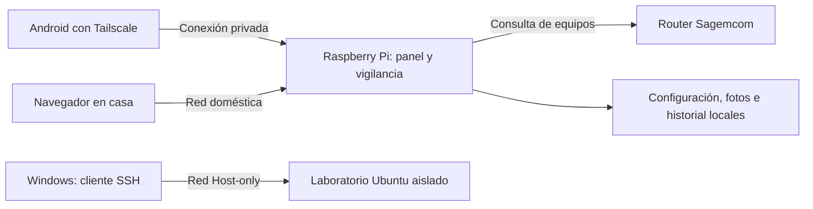

# Red bajo vigilancia

Proyecto de aprendizaje de ciberseguridad y administración de sistemas: he inventariado mi red doméstica, he preparado un laboratorio SSH aislado y he desplegado un panel de vigilancia en una Raspberry Pi 3B+.

Esta es la edición pública del código y la documentación. El inventario incluido es ficticio; la configuración del router, las credenciales, el historial doméstico y las copias permanecen fuera del repositorio. Las capturas muestran pruebas del laboratorio.

## Qué he comprobado

- He consultado la lista de equipos de mi router Sagemcom y he mostrado los estados que comunica.
- He identificado aparatos desde el panel, con nombres, funciones, fotografías y una vista por bloques de conexión.
- He registrado desconexiones y reconexiones en un historial local persistente.
- He trasladado el servidor de Windows a Raspberry Pi OS Lite de 64 bits.
- He comprobado que el servicio sigue funcionando con SSH cerrado y que vuelve a arrancar después de reiniciar la Raspberry.
- He vinculado una LG webOS, he leído su estado de encendido y he probado sus botones de encender y apagar.
- He abierto el panel desde Android mediante la dirección privada de Tailscale, con datos móviles y el PC apagado.
- He comprobado la recuperación del programa después de un fallo controlado y la reanudación de consultas tras un corte de red.
- He comprobado las copias diarias y su descarga automática a Windows, también después de reiniciar el PC.

Una consulta de red no confirma que un aparato esté encendido. La LG solo aparece como encendida cuando lo comunica webOS; si no responde, el estado queda sin confirmar. Los estados dependen de lo que informa el router, no equivalen a una detección de ataques.

## Cómo está organizado



El servidor escucha en las direcciones concretas de la red doméstica y de Tailscale configuradas en el equipo. Ambas entradas mantienen la contraseña del panel. No he configurado redirecciones de puertos del router ni Tailscale Funnel.

[Código público](https://github.com/liernimurgoitio/red-bajo-vigilancia-publico) · [Pruebas en GitHub Actions](https://github.com/liernimurgoitio/red-bajo-vigilancia-publico/actions/workflows/pruebas.yml)

## Documentación

- [Guía rápida de uso y mantenimiento](guia-rapida.md).
- [Copias privadas y recuperación](copias-seguridad.md).
- [Pruebas automáticas](pruebas-automaticas.md).
- [Inventario de la red doméstica](inventario-red.md).
- [Laboratorio SSH y pruebas de ARM](laboratorio-ssh.md).
- [Despliegue, recuperación y acceso remoto en Raspberry Pi](servidor-raspberry-pi.md).

## Archivos principales

| Archivo | Función |
| --- | --- |
| `panel-ssh.html` | Red doméstica, inventario visual, historial y laboratorio SSH |
| `scripts/vigilar_router.py` | Consulta del router y servidor del panel |
| `scripts/inventario_panel.py` | Edición y persistencia del inventario |
| `scripts/historial_red.py` | Registro de cambios en SQLite |
| `scripts/estado_tv.py` | Consulta y control de la LG vinculada |
| `scripts/fondo_ligero.py` | Recorte local de fotos en un proceso separado |
| `scripts/preparar_recorte.py` | Descarga y verificación del modelo pequeño |
| `scripts/preparar_servicio.py` | Configuración de las credenciales privadas |
| `scripts/preparar_acceso_remoto.py` | Configuración de la dirección de Tailscale del equipo |
| `red-vigilancia.service` | Unidad de systemd para el arranque automático |
| `scripts/copias_seguridad.py` | Copia privada verificada y conservación de siete versiones |
| `scripts/verificar_copia.py` | Comprobación y extracción en una carpeta nueva |
| `scripts/copiar_copias_windows.ps1` | Descarga verificada de copias a Windows |
| `tests/` | Comprobaciones con datos ficticios |

El laboratorio SSH y el análisis ARM conservan sus programas en `scripts/`. ARM agrupa tipos de evento por minuto; las pruebas controladas sirven para aprender el método y no permiten atribuir ataques.

## Preparación del servidor

He probado el servidor con Python 3.13.5 y arquitectura ARM64 en Raspberry Pi OS basado en Debian 13. El cliente del router requiere Python 3.11 o posterior.

Para descargar esta edición pública:

```bash
git clone https://github.com/liernimurgoitio/red-bajo-vigilancia-publico.git red-bajo-vigilancia
cd red-bajo-vigilancia
```

Desde la carpeta del proyecto en Linux:

```bash
python3 -m venv .venv
.venv/bin/python -m pip install -r requirements-servidor.txt
cp dispositivos.ejemplo.json dispositivos.local.json
.venv/bin/python scripts/vigilar_router.py --red-local
```

El arranque manual pide el usuario y la contraseña del router, y una contraseña propia del panel. El programa imprime la dirección que corresponde a ese equipo. La compatibilidad de la API del router y del control de TV depende del modelo y del firmware.

Para el servicio automático, las instrucciones y las pruebas están en [la documentación de la Raspberry](servidor-raspberry-pi.md). La unidad incluida utiliza el usuario genérico `admin-lab` y la ruta `/home/admin-lab/red-bajo-vigilancia`; hay que adaptarlos en otras instalaciones.

### Fotos

El panel admite JPG, PNG y WebP y conserva los PNG transparentes. Para el recorte ligero opcional:

```bash
.venv/bin/python -m pip install --only-binary=:all: -r requirements-fotos-ligero.txt
.venv/bin/python scripts/preparar_recorte.py
```

He separado el trabajo en otro proceso, con una foto cada vez y un tiempo máximo de espera. He comprobado el motor y sus validaciones localmente; falta documentar el resultado y el consumo con fotos reales procesadas en la Raspberry. Un fondo muy parecido al aparato puede producir un recorte incorrecto; el programa rechaza algunos resultados que eliminan demasiado contenido.

`requirements-fotos.txt` conserva la alternativa con Rembg para el PC; no es necesaria para vigilar la red desde la Raspberry.

## Datos privados

El repositorio contiene el código y la documentación. Estos datos se conservan fuera de Git:

- `dispositivos.local.json`: asociaciones de aparatos y claves de vinculación de TV.
- `tailscale.local.json`: dirección privada de este servidor.
- `historial-red.local.sqlite3`: cambios observados en la red.
- Credenciales del servicio en `~/.config/red-vigilancia/`, con permisos de acceso restringidos.
- Entornos virtuales, modelos descargados e imágenes o archivos de recuperación.

Las credenciales del servicio están en archivos privados; no son archivos cifrados. systemd las entrega al proceso con `LoadCredential`. El panel utiliza autenticación HTTP: en la red doméstica debe usarse en una red de confianza y el acceso exterior se realiza dentro de Tailscale.

## Límites y próximos pasos

- He recuperado el servidor después de una corrupción de las particiones de la microSD; no he demostrado la causa física del problema.
- He comprobado el acceso por Tailscale desde Android con el Wi-Fi desactivado y datos móviles. Después he apagado el PC de Windows y el panel ha seguido funcionando desde la Raspberry (17 de noviembre de 2026).
- He comprobado la recuperación ante una terminación controlada del programa: el servicio se ha reiniciado en 10 segundos, ha vuelto a consultar el router y ha conservado el historial visible.
- El panel continúa siendo un proyecto de laboratorio; no es una herramienta de monitorización de seguridad auditada.
- He activado las [copias privadas diarias](copias-seguridad.md), con verificación y conservación de siete versiones. He comprobado la primera copia manual en la Raspberry y he guardado una copia fuera de la tarjeta, en Windows. He comprobado la primera ejecución automática del 18 de noviembre y he verificado la extracción y lectura de la copia manual en una carpeta de prueba. He activado y probado la descarga verificada de las copias a Windows al iniciar sesión y cada hora. He reiniciado Windows y he comprobado una ejecución correcta de la tarea a las 15:05 del 18 de noviembre, sin volver a cargar manualmente la clave SSH. He comprobado también la recuperación tras un corte de red y el arranque de un servidor separado desde una copia ficticia. Falta ensayar la restauración de la copia real en otra instalación de Raspberry Pi OS.

## Comprobaciones repetibles

He añadido 16 pruebas de copias, historial, análisis ARM y arranque del panel desde una copia ficticia. He ejecutado todas con resultado correcto en Windows. He comprobado también una ejecución correcta de las 16 pruebas en GitHub Actions, en Linux y Windows con Python 3.11 y 3.13. Los resultados y el alcance se explican en [pruebas-automaticas.md](pruebas-automaticas.md).

El 18 de noviembre de 2026 he instalado el nuevo verificador y la ampliación de la copia en la Raspberry. He creado una copia con 46 archivos, 17 aparatos documentados y 283 registros del historial; he comprobado su contenido en la Raspberry y, después de descargarla, en Windows. El panel ha continuado activo durante la actualización.
