# Laboratorio SSH

## Entorno

- **Mi PC** utiliza Windows con PowerShell.
- **La máquina virtual** utiliza Ubuntu 24.04.3 LTS en VMware Workstation.
- **La red Host-only** permite que mi PC se comunique con Ubuntu sin conectar la máquina virtual directamente a la red doméstica.
- **OpenSSH Server** se ha instalado en Ubuntu con archivos que he descargado desde Windows y he copiado a la máquina virtual.

### Cuentas del laboratorio

- `admin-temporal` es la cuenta de administración que utilizo para trabajar desde el escritorio de Ubuntu.
- `usuario-lab` es la cuenta que utilizo para las conexiones SSH desde Windows.

Ambas cuentas tienen nombres genéricos para las capturas del proyecto.

## Primera conexión desde Windows

SSH me permite abrir una terminal de Ubuntu desde Windows.

En la primera conexión, he comparado la huella que ha mostrado PowerShell con la que he consultado en Ubuntu. La huella es un identificador que me ha ayudado a comprobar que me estaba conectando a mi máquina virtual.

Después de entrar, he ejecutado `hostname` en la sesión SSH abierta desde PowerShell. El comando ha mostrado el nombre de la máquina virtual y así he confirmado que se ha ejecutado en Ubuntu.

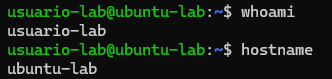

## Cómo funciona mi clave SSH

He creado un par de claves para el laboratorio.

- **La clave privada** se queda en Windows y está protegida por una frase de contraseña.
- **La clave pública** se guarda en Ubuntu, en el archivo `~/.ssh/authorized_keys`, para que Ubuntu pueda reconocer mi clave al conectarme.

### ¿Qué es Ed25519?

Ed25519 es el método de firma digital que usa mi clave SSH. Al conectarme, Windows firma unos datos de la sesión con la clave privada. Ubuntu comprueba la firma con la clave pública. Así puede verificar que tengo la clave privada sin que esta salga de Windows.

La frase de la clave sirve para desbloquearla en Windows. La contraseña de mi cuenta de Ubuntu sigue sirviendo para tareas como instalar programas.

## Prueba de acceso solo con clave

Después de desactivar el acceso por contraseña en el servidor SSH, he hecho dos pruebas desde Windows.

1. Con mi clave, la he desbloqueado con su frase y he podido entrar en Ubuntu.
2. Sin usar mi clave, Ubuntu ha rechazado la conexión con el mensaje `Permission denied (publickey)` y no me ha pedido la contraseña de mi cuenta.

Las dos pruebas han confirmado que, para entrar por SSH en este laboratorio, necesito una clave autorizada.

## Revisar el registro de conexiones

Ubuntu guarda un registro de las conexiones SSH. Para buscar las entradas aceptadas con la clave de `usuario-lab` durante los últimos cinco minutos, he ejecutado este comando.

```bash
sudo journalctl -t sshd -t sshd-session --since "5 minutes ago" --no-pager | grep "Accepted publickey for usuario-lab"
```

Ha aparecido el mensaje `Accepted publickey for usuario-lab`. Esto confirma que Ubuntu ha aceptado la clave SSH de ese usuario.

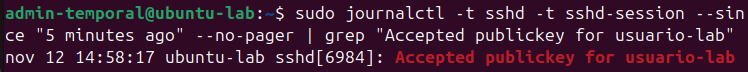

## Cortafuegos de Ubuntu

He activado el cortafuegos UFW y he añadido una regla para permitir SSH por el puerto 22.

El cortafuegos bloquea las conexiones entrantes salvo las permitidas por sus reglas. Permite las conexiones que Ubuntu inicia.

Después de activarlo, he abierto una nueva conexión SSH desde Windows. He podido entrar con mi clave, confirmando que la regla permite el acceso.

He consultado el estado y las reglas con este comando.

```bash
sudo ufw status verbose
```

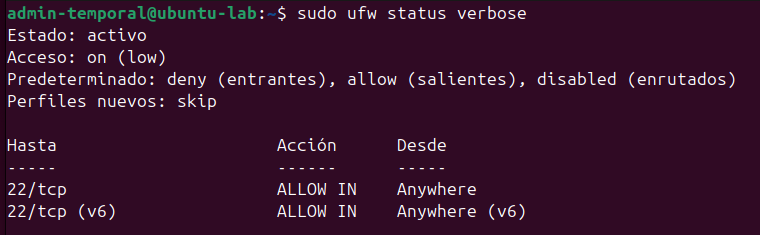

## Comprobación con Nmap

Desde PowerShell en Windows he comprobado el puerto SSH de Ubuntu.

```powershell
nmap -sT -p 22 IP_DE_UBUNTU
```

Nmap ha mostrado este resultado.

```text
22/tcp open ssh
```

Esto confirma que el puerto 22 acepta conexiones desde mi PC. Para entrar en Ubuntu por SSH sigue siendo necesaria mi clave autorizada.

## Revisión de la red del laboratorio

He consultado las rutas de Ubuntu con estos comandos.

```bash
ip -4 route
ip -6 route
```

En IPv4 solo ha aparecido la red virtual del laboratorio. En IPv6 solo ha aparecido una ruta de alcance local.

No ha aparecido una ruta predeterminada en ninguna de las dos consultas. Esto indica que Ubuntu no tenía una salida directa configurada hacia otras redes en el momento de la prueba.

## Prueba después de reiniciar

He reiniciado Ubuntu y he vuelto a conectarme desde Windows con mi clave SSH.

Después he consultado el cortafuegos.

```bash
sudo ufw status
```

He comprobado que el cortafuegos sigue activo y conserva la regla que permite SSH por el puerto 22.

## Punto de recuperación

Con Ubuntu apagado, he guardado una instantánea en VMware llamada **SSH con clave y cortafuegos — verificado**.

Permite devolver la máquina virtual al estado comprobado en estas pruebas. Al restaurarla, los cambios posteriores de Ubuntu pueden perderse.

La clave privada sigue guardada por separado en Windows.

## Observar una conexión en directo

He abierto el registro en una terminal de Ubuntu.

```bash
sudo journalctl -u ssh.service -f -n 0
```

Después me he conectado desde PowerShell. Han aparecido los mensajes `Accepted publickey` y `session opened`.

He cerrado la conexión escribiendo `exit` en PowerShell y he vuelto a Windows.

Para localizar el cierre, he consultado los mensajes del programa SSH.

```bash
sudo journalctl -t sshd -t sshd-session --since "10 minutes ago" --no-pager
```

He encontrado `disconnected by user`, `Disconnected from user usuario-lab` y `session closed`. Estos mensajes han confirmado que la sesión ha terminado.

Los nombres de usuario de los ejemplos antiguos se han sustituido por `usuario-lab` para proteger la privacidad.

## Observar un intento de acceso sin clave

He dejado abierto el registro de SSH en Ubuntu.

```bash
sudo journalctl -f -n 0 -t sshd -t sshd-session
```

Desde Windows he intentado conectarme con el uso de claves desactivado. PowerShell ha respondido con este mensaje.

```text
Permission denied (publickey).
```

Ubuntu ha registrado `Connection reset by authenticating user` y `[preauth]`. Esto indica que la conexión ha terminado antes de completar el acceso.

El resultado de Windows ha confirmado que el servidor exige una clave SSH.

## Programas que esperan conexiones

He consultado los puertos TCP con este comando.

```bash
sudo ss -lntp
```

He comprobado que SSH escucha en el puerto 22 para recibir conexiones desde Windows.

También han aparecido el servicio de impresión en el puerto 631 y el servicio de búsqueda de nombres en el puerto 53. Ambos escuchan solo en direcciones internas de Ubuntu.

Un programa puede estar escuchando sin que su puerto sea accesible desde otra máquina. También influyen la dirección donde escucha y el cortafuegos.

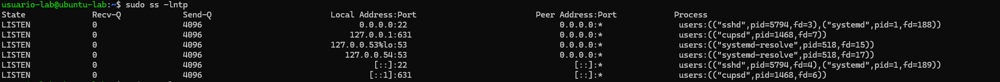

## Comparar puertos desde Windows

He comprobado los puertos 22 y 631 de Ubuntu desde PowerShell.

```powershell
nmap -sT -p 22,631 IP_DE_UBUNTU
```

- El puerto 22 ha aparecido como `open`. Windows puede conectar con SSH.
- El puerto 631 ha aparecido como `filtered`. Nmap no ha podido comprobar si está abierto o cerrado porque sus pruebas han sido filtradas.

El resultado del puerto 631 coincide con el bloqueo de conexiones entrantes del cortafuegos. Además, en la revisión dentro de Ubuntu he comprobado que el servicio de impresión escucha solo en direcciones internas.

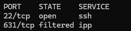

## Ver un bloqueo del cortafuegos

En Ubuntu he dejado abierto el registro de conexiones bloqueadas.

```bash
sudo journalctl -k -f -n 0 | grep --line-buffered 'UFW BLOCK'
```

Desde PowerShell en Windows he comprobado el puerto 631.

```powershell
nmap -sT -p 631 IP_DE_UBUNTU
```

Ubuntu ha mostrado mensajes con estos datos.

- `UFW BLOCK` indica que el cortafuegos ha bloqueado el tráfico.
- `PROTO=TCP` identifica el protocolo utilizado.
- `DPT=631` identifica el puerto de destino.

Así he confirmado que el cortafuegos ha bloqueado las pruebas dirigidas a ese puerto. He ocultado las direcciones y otros datos de red antes de guardar la captura.

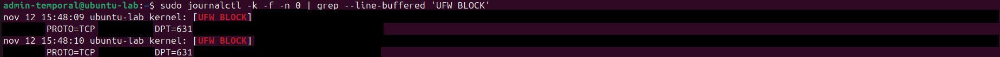

## Desactivar la entrada directa como root

`root` es la cuenta con control completo de Ubuntu.

He configurado SSH para impedir la entrada directa con esa cuenta mediante este ajuste.

```text
PermitRootLogin no
```

He comprobado que la configuración no tiene errores y he recargado el servicio SSH. Después he abierto una conexión nueva desde Windows con `usuario-lab` y he podido entrar correctamente.

Para realizar tareas de administración sigo usando mi cuenta con `sudo`.

## Detector de conexiones SSH

He creado el programa `scripts/vigilar_ssh.py` para mostrar avisos fáciles de entender a partir del registro de SSH.

El programa reconoce dos situaciones.

- `ACCESO ACEPTADO` indica que Ubuntu ha aceptado una conexión con clave SSH.
- `CONEXIÓN SIN COMPLETAR` indica que la conexión ha terminado antes de completar el acceso. Este aviso por sí solo no demuestra un ataque.

### Cómo lo ejecuto

En Ubuntu, desde la carpeta que contiene el programa, compruebo primero el permiso para leer el registro.

```bash
sudo -v
```

Después inicio el detector.

```bash
sudo -n stdbuf -oL journalctl -f -n 0 -o cat -t sshd -t sshd-session | python3 -u vigilar_ssh.py
```

`journalctl` sigue los nuevos mensajes de SSH. `stdbuf -oL` permite entregarlos línea por línea al programa. Python los lee y muestra el aviso correspondiente.

### Pruebas realizadas

1. Me he conectado desde Windows con mi clave. Ha aparecido `ACCESO ACEPTADO`.
2. He intentado conectarme con el uso de claves desactivado. Windows ha rechazado el acceso y el detector ha mostrado `CONEXIÓN SIN COMPLETAR`.

El detector funciona mientras la terminal permanece abierta. Para detenerlo, pulso **Ctrl + C**.

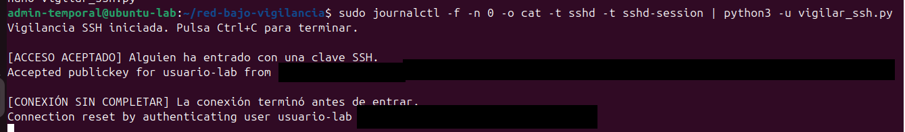

## Guardar eventos en CSV

He ampliado el detector para guardar los mensajes reconocidos en `eventos_ssh.csv`.

Cada fila contiene dos datos.

- `fecha_observada` indica cuándo ha recibido el detector el mensaje.
- `tipo_evento` indica si se trata de un acceso aceptado o de una conexión sin completar.

El programa está guardado en `scripts/vigilar_ssh.py`. El CSV se guarda junto al programa en Ubuntu.

Los eventos se conservan entre ejecuciones. Una conexión puede generar varios mensajes, por lo que cada fila no equivale necesariamente a una conexión distinta.

He copiado el CSV a `datos/eventos_ssh.csv` dentro del proyecto de Windows para utilizarlo en el panel y en el análisis ARM.

## Panel visual

He incorporado el panel al archivo `panel-ssh.html`. Para abrirlo, hago doble clic sobre él en Windows y selecciono `datos/eventos_ssh.csv`.

Muestra contadores, una gráfica por hora y una tabla con filtros.

He comprobado que carga los dos eventos iniciales de prueba y que el filtro de conexiones sin completar muestra solo el mensaje correspondiente.

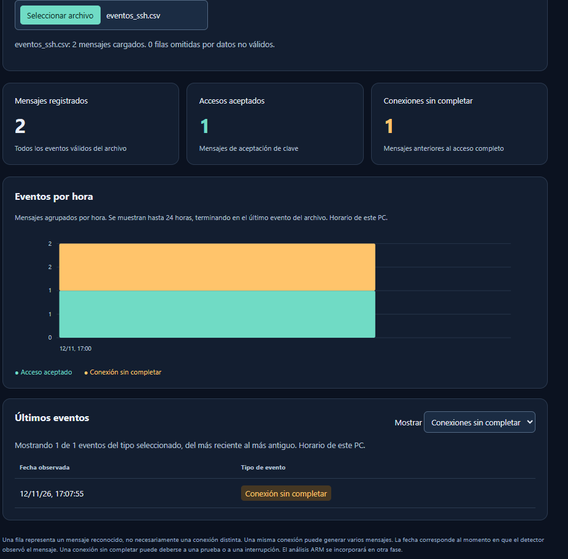

El panel recuerda el último CSV cargado en este navegador y lo recupera al refrescar la página. He comprobado que los eventos siguen visibles tras pulsar **F5**.

El botón **Borrar datos recordados** elimina esa copia del navegador.

Para incorporar eventos nuevos, copio el CSV actualizado desde Ubuntu y vuelvo a seleccionarlo en el panel.

## Primera prueba de minería de reglas de asociación (ARM)

ARM busca eventos que aparecen juntos con frecuencia.

He agrupado los mensajes del detector por minutos. Cada minuto cuenta una vez, aunque contenga varios mensajes del mismo tipo. Solo he incluido minutos con eventos.

### Pruebas realizadas

El 12 de noviembre de 2026 he preparado tres rondas.

| Minuto | Eventos |
| --- | --- |
| 17:43 | Acceso aceptado |
| 17:44 | Conexión sin completar |
| 17:45 | Ambos eventos |

He analizado el intervalo desde las 17:43 hasta las 17:46, sin incluir este último minuto, con `scripts/analizar_arm.py`.

Desde la carpeta principal del proyecto en Windows he ejecutado este comando.

```powershell
python scripts/analizar_arm.py --desde "2026-11-12T17:43:00+01:00" --hasta "2026-11-12T17:46:00+01:00"
```

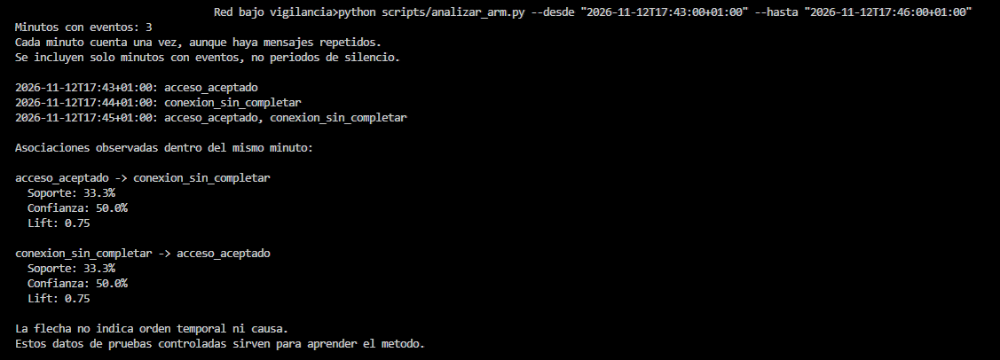

### Resultados

Las asociaciones en ambos sentidos han dado los mismos valores.

- **Soporte del 33,3 %**. Ambos eventos han coincidido en uno de los tres minutos.
- **Confianza del 50 %**. De los dos minutos con un tipo de evento, uno también ha contenido el otro.
- **Lift de 0,75**. Los eventos han coincidido menos de lo esperado si fueran independientes dentro de esta muestra.

La flecha entre eventos no indica cuál ha ocurrido primero ni que uno haya causado el otro.

### Visualización en el panel

He añadido una sección ARM al panel con un selector de fechas. He comprobado que sus resultados coinciden con los del programa de Python.

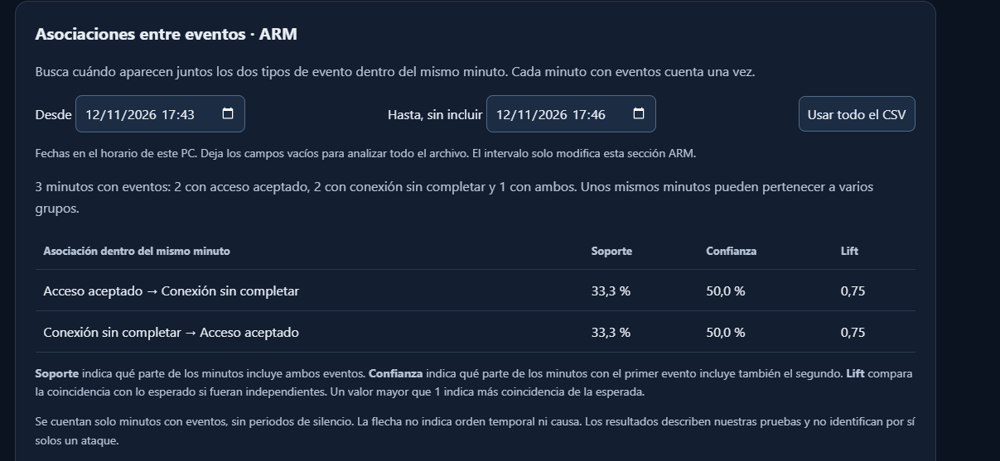

### Límites de la prueba

He preparado estas tres rondas para aprender el procedimiento. Son pocos datos para sacar conclusiones sobre seguridad.

Los resultados dependen del intervalo elegido y de cómo se agrupan los mensajes. Una asociación por sí sola no demuestra un ataque.

## Segunda prueba ARM

He analizado dos nuevas rondas del 12 de noviembre de 2026.

| Minuto | Eventos |
| --- | --- |
| 20:41 | Ambos eventos |
| 20:42 | Acceso aceptado |

He seleccionado el intervalo desde las 20:41 hasta las 20:43,
sin incluir el último minuto.

La asociación «acceso aceptado → conexión sin completar» ha tenido
una confianza del 50 %. De los dos minutos con acceso aceptado,
solo uno ha contenido también una conexión sin completar.

En sentido contrario, la confianza ha sido del 100 %. El único minuto
con una conexión sin completar también ha contenido un acceso aceptado.

Ambas asociaciones han tenido un soporte del 50 % y un lift de 1.
Como todos los minutos han contenido un acceso aceptado, la confianza
del 100 % resulta esperable en esta muestra.

He comprobado que Python y el panel han mostrado los mismos resultados.

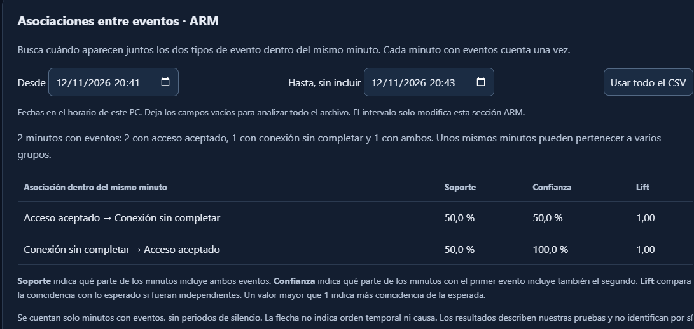

## Varios mensajes dentro del mismo minuto

El 13 de noviembre de 2026 he generado tres intentos de conexión
sin clave a las 14:44:05.

El detector ha guardado tres filas en el CSV. Al analizar el intervalo
desde las 14:44 hasta las 14:45, ARM ha contado un único minuto
con el evento `conexion_sin_completar`.

No han aparecido reglas porque ese minuto no ha contenido ningún
acceso aceptado.

He comprobado que Python y el panel han mostrado el mismo resultado.
Así he verificado que repetir un tipo de evento dentro de un minuto
no aumenta el número de grupos del análisis.

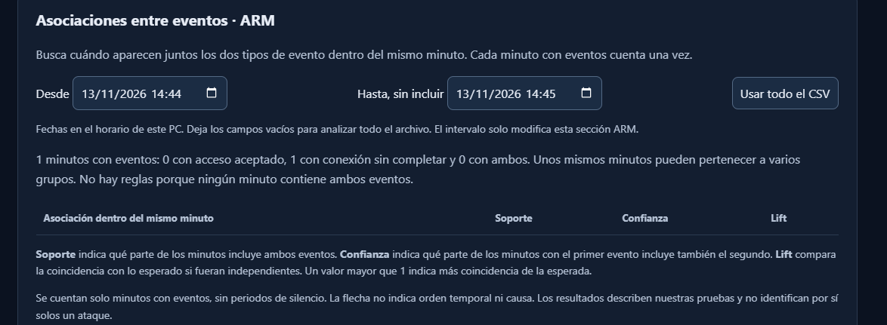

## Contar mensajes por minuto

He añadido al panel una tabla que cuenta los mensajes de cada tipo
dentro del intervalo seleccionado.

He comprobado el minuto del 13 de noviembre de 2026 a las 14:44.
La tabla ha mostrado cero accesos aceptados y tres conexiones
sin completar, con un total de tres mensajes.

ARM ha contado un único minuto con eventos y no ha generado reglas.
Así he comprobado la diferencia entre contar mensajes y agrupar
la presencia de cada tipo de evento por minuto.

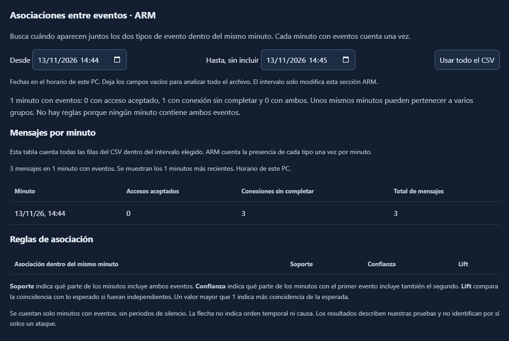

## Panel de la red doméstica conectado al router

He conectado el panel al router Sagemcom F@st 5670 de Euskaltel
para consultar su lista de dispositivos.

He comprobado la lectura con `scripts/probar_router.py`.
Después he utilizado `scripts/vigilar_router.py` para actualizar
el panel aproximadamente cada minuto.

Para iniciar la vigilancia desde la carpeta del proyecto en Windows, uso:

    .venv\Scripts\python.exe scripts/vigilar_router.py

El programa me pide el usuario y la contraseña del router.
La contraseña se mantiene en memoria durante la ejecución.

### Información del panel

En la comprobación de la captura, el router ha informado de 48 equipos
conocidos, con 14 conectados y 34 desconectados.

Los equipos desconectados forman parte del historial del router.
El panel permite filtrar por estado, conexión y alias.

He utilizado nombres genéricos para los equipos pendientes de identificar.
Los seis aparatos del inventario se muestran en una sección separada.

He comprobado que los encabezados de las tablas permanecen visibles
al desplazarme por la lista.

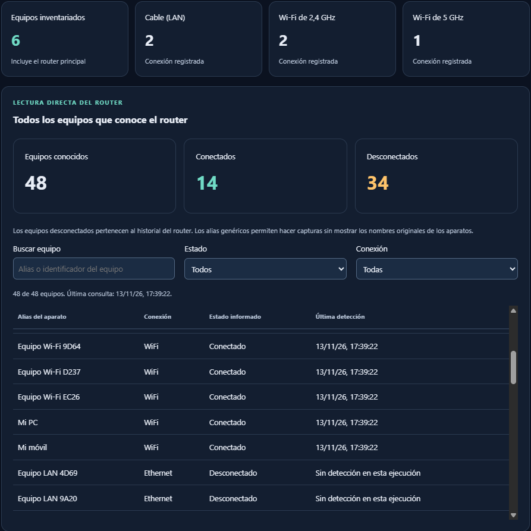

### Funcionamiento y privacidad

La vigilancia continúa mientras Windows y el programa están encendidos.
El panel muestra la hora de la última consulta y avisa si pierde
la conexión con el programa.

Los estados representan lo que ha informado el router en cada consulta.
La última detección se conserva durante la ejecución del programa.

El archivo `dispositivos.local.json` contiene la configuración privada
y se ha excluido de Git mediante `.gitignore`.

## Prueba de desconexión y reconexión

He comprobado el seguimiento con una Alexa que he identificado en el panel.

La he desenchufado y el panel ha actualizado su estado a Desconectada.
Después la he vuelto a enchufar y ha aparecido como Conectada.

En esta prueba, cada cambio ha tardado aproximadamente un minuto
en reflejarse en el panel.

He confirmado que el seguimiento funciona en ambos sentidos.